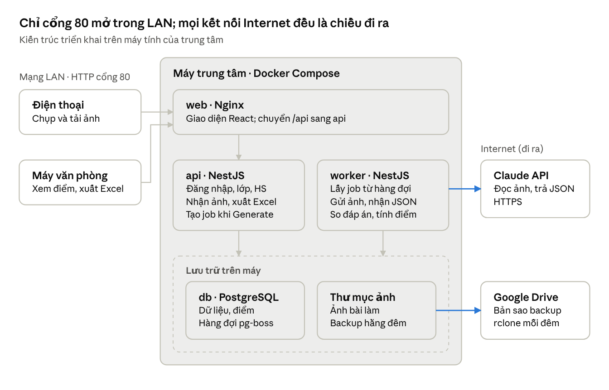
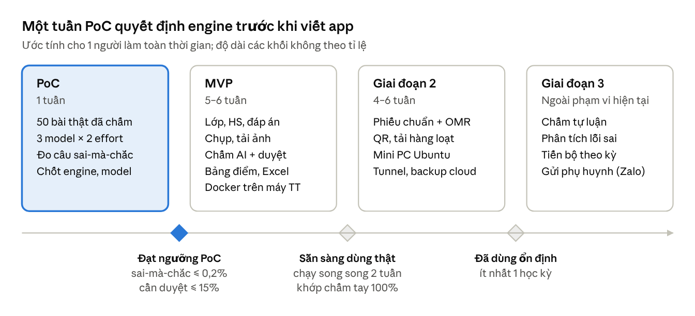

# MissNgoc Grader

Web app chấm bài trắc nghiệm và điền từ cho trung tâm tiếng Anh. Nhân viên chụp bài làm của từng học sinh bằng điện thoại. Admin tải đáp án lên. Bấm **Generate** là có ngay bảng điểm cả lớp, xem được trên web và xuất ra Excel theo mẫu màu của trung tâm.

**Trạng thái:** đã có code MVP giai đoạn 1 (16/10/2026), chạy được toàn luồng với engine giả (`mock`). Bước tiếp theo: thử AI đọc 1–2 bài thật bằng Gemini (miễn phí), rồi chạy PoC 50 bài để chọn model.

## Tài liệu

| Tài liệu | Nội dung |
| --- | --- |
| [missngoc.docs/ba-architecture.md](missngoc.docs/ba-architecture.md) | BA (use case, yêu cầu chức năng, mức độ hữu ích, rủi ro) và kiến trúc (stack, data model, REST API, triển khai LAN, Docker, lộ trình) |
| [missngoc.docs/api-pricing.md](missngoc.docs/api-pricing.md) | So sánh giá API đọc bài: Gemini, Claude, ChatGPT; chi phí mỗi bài và mỗi tháng (có số token đo thật) |
| [missngoc.docs/deploy-center.md](missngoc.docs/deploy-center.md) | Cài lên máy trung tâm để thử ở văn phòng: 2 cách đưa bản cài, kiểm tra sau cài, cập nhật, sao lưu, sự cố thường gặp |
| [missngoc.docs/finetune-analysis.md](missngoc.docs/finetune-analysis.md) | Có nên fine-tune không, chọn model nào (Vertex AI Gemini, Qwen3-VL tự host), chi phí, cách dùng dữ liệu hằng ngày, lộ trình |
| [Bản online trên Claude Docs](https://claude.ai/code/artifact/097eaa2d-8d33-4a9a-a497-222c0896e2f8) | Cùng nội dung, góp ý bằng bình luận |

## Quyết định chính

- **Nền tảng:** web mobile-first, không làm app trên App Store
- **Nơi chạy:** máy tính của trung tâm, trong mạng LAN. Không cần mở port trên router, chỉ cần 1 rule Windows Firewall cho cổng 80
- **Tài khoản:** trung tâm cấp, không có đăng ký. RBAC động theo IUROADMAP, vai trò mặc định Admin, Giáo vụ (`STAFF`), Giáo viên (`TEACHER`)
- **Cách chấm:** AI chỉ đọc học sinh chọn gì, hoặc chép lại chữ học sinh viết ở câu điền từ. Code so với đáp án và tính điểm. Câu điền từ không phân biệt chữ hoa/thường và dấu chấm cuối, nhưng sai chính tả là sai. Viết lại câu và bài viết không chấm trên app. Câu AI không chắc được đưa vào màn hình duyệt. Engine đổi bằng biến `GRADING_ENGINE`: `claude` (chạy thật), `gemini` (thử miễn phí), `mock` (không gọi AI). Ghi nhiều engine như `gemini,claude` thì bài nào engine đầu lỗi hoặc hết lượt sẽ chuyển sang engine sau
- **Stack:** React 18 + Vite + Ant Design, NestJS + Prisma + PostgreSQL, REST API. Cấu trúc theo repo [IUROADMAP](https://github.com/TanjiKhanh/IUROADMAP)
- **Đóng gói:** Docker Compose gồm web (Nginx), api, worker, db, backup
- **Giai đoạn 2:** phiếu trả lời chuẩn + OMR (OpenCV), chạy offline và gần như không tốn chi phí



## Cấu trúc thư mục

```text
missngoc-grader/
├─ missngoc.services/api/     NestJS: api (HTTP) + worker (chấm bài), Prisma, script PoC
├─ missngoc.webapp/apps/web/  React 18 + Vite + Ant Design + Redux Toolkit + TanStack Query
├─ missngoc.webapp/packages/core/  quyền (PMS), trạng thái, đường dẫn dùng chung
├─ missngoc.docs/             tài liệu BA và kiến trúc
└─ deploy/                    docker-compose.yml (máy chủ), docker-compose.dev.yml (Postgres cho dev), nginx.conf
```

## Chạy trên máy dev

Cần Node.js 22+, Docker Desktop và Python 3.12 (cho trình biên dịch ExamDSL).

```bash
npm install
pip install -r missngoc.dsl/requirements.txt    # trình biên dịch ExamDSL
npm run db:up                                   # Postgres trong Docker, chỉ mở cho máy này
cp missngoc.services/api/.env.example missngoc.services/api/.env   # điền JWT_SECRET
npm run db:setup                                # migrate, seed quyền, tạo tài khoản admin
npm run dev                                     # Postgres + API (kèm worker) + ExamDSL (:8010) + web: http://localhost:5173
```

Kéo code mới có migration thì chạy lại `npm run db:setup` (hoặc `npx prisma migrate deploy` trong `missngoc.services/api`).

Đăng nhập `admin` với `ADMIN_PASSWORD` trong `.env`, đổi mật khẩu, rồi cấp tài khoản cho giáo vụ. Điện thoại cùng Wi-Fi mở `http://<IP máy dev>:5173`.

Kiểm tra: `npm run test` (unit test chấm điểm và test ExamDSL), `npm run typecheck`.

## Thử AI đọc 1–2 bài bằng Gemini (miễn phí)

1. Tạo API key ở [Google AI Studio](https://aistudio.google.com), điền `GEMINI_API_KEY` vào `missngoc.services/api/.env`.
2. Chụp 1–2 bài, đặt vào `poc-samples/` (thư mục này không đưa lên git). Bài nhiều trang thì để các trang trong một thư mục con.
3. Chạy từ thư mục gốc:

```bash
npm run poc -- --engine gemini --questions 40 poc-samples/bai1.jpg poc-samples/bai2
```

Kết quả in từng câu: `A` là đọc rõ, `A?` là không chắc, `·` là bỏ trống. Thêm `--truth poc-samples/truth.csv` (cột `sheet,q,choice`) để so với đáp án chấm tay và tính tỉ lệ sai mà AI vẫn báo chắc chắn.

Đề có câu điền từ thì thêm `--text`, ví dụ đề Unit 1–3 có 41 câu, câu 5–8 và 18–21 là điền từ:

```bash
npm run poc -- --engine gemini --questions 41 --text 5-8,18-21 poc-samples/de-unit1-3
```

Trong `truth.csv`, câu điền từ ghi đúng chữ học sinh viết, kể cả sai chính tả (không ghi đáp án đúng). Kết quả có dòng riêng cho câu điền từ: câu sai mà AI chép thành đúng chính tả là lỗi AI tự sửa chữ, lỗi cần đo kỹ nhất.

Ảnh mẫu (16 phiếu tổng hợp nhiều kiểu + bài viết tay thật từ Mendeley, có đáp án chuẩn) nằm ở `poc-samples/datasets/`, xem `poc-samples/datasets/README.md`.

**Lưu ý:** gói miễn phí của Gemini chỉ cho 20 lượt gọi mỗi ngày (mỗi bài là 1 lượt), hết lượt thì báo lỗi 429. Dữ liệu gửi qua Gemini bản miễn phí có thể được Google dùng để cải thiện sản phẩm. Che họ tên trên ảnh, hoặc dùng phiếu mẫu do nhân viên tô. Muốn thử cả luồng trên web thì đặt `GRADING_ENGINE=gemini` và `GRADING_CONCURRENCY=2` trong `.env`.

## Cài lên máy trung tâm

Hướng dẫn đầy đủ (chuẩn bị máy, 2 cách đưa bản cài, điền `.env`, mở LAN, kiểm tra, cập nhật, sao lưu, sự cố): [missngoc.docs/deploy-center.md](missngoc.docs/deploy-center.md). Tóm tắt khi máy có mã nguồn:

```bash
cd deploy
cp .env.example .env            # điền DB_PASSWORD, JWT_SECRET, API key, ADMIN_PASSWORD, PUBLIC_URL
docker compose up -d --build    # cài lần đầu và mỗi lần cập nhật: web, api, worker, db, dsl, backup
docker compose run --rm api node dist/scripts/bootstrap-admin.js   # tạo admin đầu tiên
```

## Lộ trình



1. **PoC (1 tuần):** cho AI đọc 50 bài thật đã chấm tay, so sánh 3 model. Chỉ làm tiếp khi tỉ lệ câu sai mà AI vẫn báo chắc chắn không quá 0,2%
2. **MVP (5–6 tuần):** lớp, học sinh, đáp án, chụp ảnh, chấm và duyệt, bảng điểm, xuất Excel, cài lên máy trung tâm
3. **Giai đoạn 2:** phiếu chuẩn + OMR, mã QR để tải bài hàng loạt, mini PC chạy Ubuntu
4. **Giai đoạn 3 (ngoài phạm vi hiện tại):** chấm tự luận, phân tích lỗi sai về ngữ pháp và từ vựng

## Ý tưởng đồ án DSL (môn Nguyên lý ngôn ngữ lập trình)

**Trạng thái:** đã cài đặt trong [missngoc.dsl/](missngoc.dsl/README.md) và gắn vào app: trang **Soạn đề** (`/exams/:id/dsl`, nút "Soạn bằng ExamDSL" ở trang bài kiểm tra), và lối **tạo bài bằng ExamDSL** ngay trong hộp thoại Tạo bài kiểm tra. Thiết kế chi tiết (grammar, bảng lỗi, codegen): [missngoc.docs/examdsl-design.md](missngoc.docs/examdsl-design.md). Deck demo luồng sử dụng: [missngoc.docs/MissNgoc-Demo-Flow.pptx](missngoc.docs/MissNgoc-Demo-Flow.pptx).

MissNgoc có sẵn đúng luồng mà một DSL cần: AI đọc ảnh bài làm thành JSON (`q`, `choice`, `text`, `status`), sau đó code so với đáp án và tính điểm. Hiện các quy tắc giáo viên hay muốn đổi (số câu, loại câu, đáp án, điểm từng phần, dải điểm, màu, khi nào phải duyệt) đang viết cứng trong code TypeScript và cấu hình JSON. DSL thay phần này bằng một file văn bản do admin tự viết.

### ExamDSL: mỗi bài kiểm tra là một file `.exam`

```text
exam "Unit 1-3" {
  questions 41
  options A B C D
  max 10
  versions 101 102

  section Grammar  1-4, 9-17   choice
  section Vocab    5-8, 18-21  text  match ignore-case
  section Reading  22-41       choice weight 2

  key 101 {
    1-4  A C B D
    5    "eight hours" / "8 hours"
    6    "beautiful"
    ...
  }
  key 102 { ... }
}

report {
  band "Giỏi"        >= 8    #C6EFCE
  band "Khá"         >= 6.5  #DDEBF7
  band "Trung bình"  >= 5    #FFEB9C
  band "Cần cố gắng" else    #FFC7CE
}

review {
  if answer.status in ("unclear", "multiple") then flag
  if submission.name_mismatch then flag "Tên không khớp"
}
```

Ví dụ dùng đúng đề Unit 1–3 ở trên: 41 câu, câu 5–8 và 18–21 là điền từ. Nhiều cách viết đúng thì ngăn bằng `/`, giống file import đáp án.

### Áp dụng các phần của môn học

| Pha | Làm gì trong ExamDSL | Bài giảng |
| --- | --- | --- |
| Phân tích từ vựng (lexer) | Khoảng câu `5-8`, số thập phân, mã màu `#C6EFCE`, chữ cái lựa chọn, chuỗi tiếng Việt | 2, 3 |
| Phân tích cú pháp (parser) | Khối lồng nhau `exam` / `section` / `key`, luật `if … then` trong `review` | 5, 6 |
| Phân tích ngữ nghĩa | `1-4 A C B` có 3 đáp án cho 4 câu. `E` không có trong `options`. Câu 23 không thuộc phần nào. Câu 8 nằm ở 2 phần. Mã đề 102 thiếu câu 30–31. Câu trắc nghiệm lại ghi đáp án chữ. Có dải điểm không bao giờ đạt tới | 8 |
| Ràng buộc tên và phạm vi | Tên phần, mã đề, các trường `answer.*` và `submission.*` trong luật (viết `answer.statu` thì báo lỗi) | 10 |
| Visitor và thông dịch | Chạy luật chấm điểm và luật duyệt trên JSON mà AI trả về | 11 |
| Sinh mã | Xuất ra JSON mà app đang nhận (xem mục dưới) | 12 |
| Tối ưu | Gộp hằng số trong trọng số và điểm, gộp các khoảng câu liền nhau | 13 |

Phần lớn bộ kiểm tra ngữ nghĩa đã có sẵn trong [scoring.ts](missngoc.services/api/src/modules/grading/scoring.ts), chỉ cần chuyển thành một pass của trình biên dịch. `missingQuestions` và `kindConflicts` vốn là kiểm tra ngữ nghĩa, còn `isAnswerCorrect` là phần chạy cho `match ignore-case`.

### Đầu ra

1. Các dòng đáp án (`q`, `kind`, `correct[]`, `points`). Điểm tính từ `weight` và `max`, thay cho cách chia đều của `defaultPoints` hiện nay
2. JSON `ReportTemplateConfig`. Schema zod trong [report-template.ts](missngoc.services/api/src/modules/reports/report-template.ts) kiểm tra luôn đầu ra
3. Phần "Sheet layout" của prompt AI (các lựa chọn, các câu điền từ). Hiện `buildPrompt` trong [prompt.ts](missngoc.services/api/src/modules/grading/engines/prompt.ts) đang ghép tay phần này
4. Mở rộng: phiếu trả lời để in và tọa độ ô tô cho OMR ở giai đoạn 2, sinh từ cùng một bố cục

### Cách làm

Làm theo cấu trúc DiagramDSL (bài mẫu của môn): Python + ANTLR 4.9.2, có CLI và trang web soạn thảo báo lỗi ngay khi gõ. Trình biên dịch chạy riêng và xuất JSON để API MissNgoc nhập vào. Như vậy đồ án tự chạy được để chấm, mà vẫn có người dùng thật.

```text
missngoc.dsl/                 (đề xuất)
├─ grammar/ExamDSL.g4
├─ dsl/                       ast_builder.py, semantic.py, interpreter.py, codegen/
├─ examples/unit1-3.exam
└─ cli.py                     python cli.py examples/unit1-3.exam --emit answer-keys
```

Nếu muốn chạy ngay trong app thì dùng target JavaScript/TypeScript của ANTLR. Khi đó cùng một grammar chạy được cả trong NestJS lẫn trong trình soạn thảo trên web.

ExamDSL khác hai bài mẫu của môn: DiagramDSL chỉ khai báo và sinh mã, WasteSortingDSL chỉ chạy luật `IF/THEN`. ExamDSL cần cả hai, thêm kiểm tra phạm vi và kiểu thật sự.

### Phương án nhỏ hơn

- **Chỉ luật duyệt** (khối `review { if … then flag }`): dễ nhất, nhưng gần giống WasteSortingDSL và đồ án Group 4
- **Chỉ DSL bảng điểm** (dải điểm, tô màu có điều kiện, sinh file `.xlsx`): nhỏ, chủ yếu là sinh mã
- **DSL bố cục phiếu trả lời** (sinh phiếu tô để in và bản đồ ô cho OMR): mới nhất, nhưng phụ thuộc phần OMR của giai đoạn 2

## Việc cần làm tiếp

- [ ] Thử Gemini với 1–2 bài thật (đã che tên) bằng `npm run poc`
- [ ] Thử 1–2 bài đề Unit 1–3 có câu điền từ (`--text 5-8,18-21`), xem AI có tự sửa chính tả không
- [ ] Xác định học sinh làm bài trên phiếu tô ô riêng hay khoanh ngay trên đề
- [ ] Ghi lại số câu mỗi bài, số mã đề, thang điểm, số bài mỗi tháng
- [ ] Tạo API key và đặt hạn mức chi tiêu tháng trên Claude Console
- [ ] Thu 50 bài mẫu đã chấm tay cho PoC
