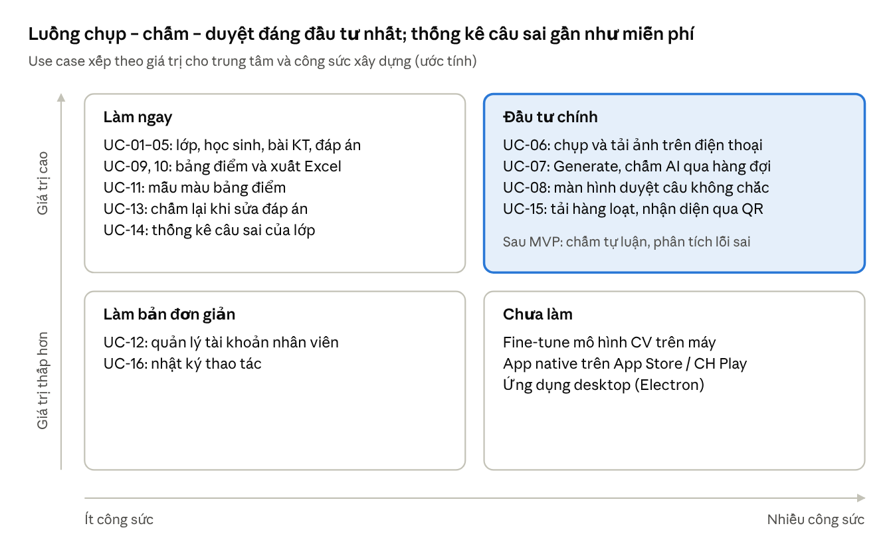
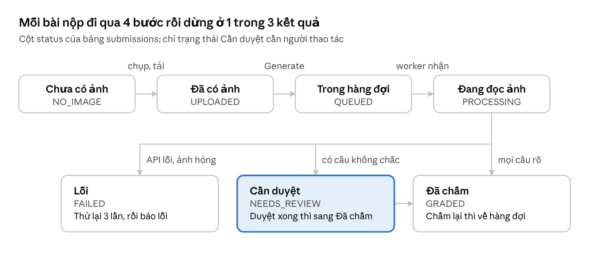

# Ứng dụng chấm trắc nghiệm — BA & Kiến trúc

Cập nhật: 16/10/2026 · Bản online (có bình luận): [Claude Docs](https://claude.ai/code/artifact/097eaa2d-8d33-4a9a-a497-222c0896e2f8)

## Mục lục

- [1. Tóm tắt và khuyến nghị](#1-tóm-tắt-và-khuyến-nghị)
- [2. Bối cảnh, mục tiêu và phạm vi](#2-bối-cảnh-mục-tiêu-và-phạm-vi)
- [3. Tác nhân, use case và yêu cầu chức năng](#3-tác-nhân-use-case-và-yêu-cầu-chức-năng)
- [4. Đánh giá mức độ hữu ích](#4-đánh-giá-mức-độ-hữu-ích)
- [5. Yêu cầu phi chức năng và rủi ro](#5-yêu-cầu-phi-chức-năng-và-rủi-ro)
- [6. Phương án chấm: AI API, OMR hay fine-tune](#6-phương-án-chấm-ai-api-omr-hay-fine-tune)
- [7. Ngôn ngữ và cơ sở dữ liệu](#7-ngôn-ngữ-và-cơ-sở-dữ-liệu)
- [8. Kiến trúc hệ thống](#8-kiến-trúc-hệ-thống)
- [9. Mô hình dữ liệu](#9-mô-hình-dữ-liệu)
- [10. Triển khai: web hay desktop, LAN và tường lửa](#10-triển-khai-web-hay-desktop-lan-và-tường-lửa)
- [11. Đóng gói bằng Docker](#11-đóng-gói-bằng-docker)
- [12. Lộ trình](#12-lộ-trình)

## 1. Tóm tắt và khuyến nghị

Nên làm **web app mobile-first chạy trên máy tính của trung tâm (mạng LAN), đóng gói bằng Docker Compose, dùng React (Ant Design) + NestJS + PostgreSQL, theo cấu trúc repo IUROADMAP và REST API**. Đây là stack bạn đã biết và đủ cho bài toán này. Không cần Java Spring Boot hay SQL Server.

| Quyết định | Khuyến nghị | Lý do chính |
| --- | --- | --- |
| Nền tảng | Web responsive, mở bằng trình duyệt điện thoại | Không qua App Store. Nút chụp ảnh của trình duyệt chạy được cả trên HTTP nội bộ |
| Nơi chạy server | Máy tính trung tâm, trong mạng LAN | Không cần mở port trên router. Chỉ cần 1 rule Windows Firewall cho cổng 80 |
| Cách chấm | AI chỉ **đọc** học sinh chọn gì, còn code tự so với đáp án và tính điểm | Không gửi đáp án lên AI. Sửa đáp án thì chấm lại ngay, không tốn tiền API. Kiểm tra lại được |
| Engine đọc ảnh | Giai đoạn 1: Claude vision API. Giai đoạn 2: phiếu trả lời chuẩn + OpenCV (OMR) | AI đọc được ngay giấy thi hiện tại. OMR rẻ hơn và chính xác hơn khi đã chuẩn hóa phiếu |
| Fine-tune CV trên máy | Chưa làm | Cần hàng nghìn ảnh gán nhãn và GPU. OMR cổ điển đã giải được bài toán phiếu tô |
| Backend / DB | Một ứng dụng NestJS + PostgreSQL + Prisma, REST API, layout module như IUROADMAP | Postgres đảm bảo ACID ngang SQL Server. Bảo mật nằm ở cách code, không ở ngôn ngữ |
| Kiểm soát sai sót | Màn hình duyệt: câu AI không chắc được tô vàng, nhân viên sửa bằng 1 chạm | AI không đúng 100%, mà điểm gửi phụ huynh thì phải đúng |
| Đóng gói | Docker Compose: web, api, worker, db, backup | Cài bằng 1 lệnh, cập nhật bằng 1 lệnh, chuyển lên cloud không phải sửa code |

**Việc nên làm đầu tiên:** PoC 1 tuần. Chụp 50 bài thật, cho chạy qua API, rồi đo tỉ lệ đọc đúng từng câu. Kết quả PoC sẽ quyết định dùng engine nào và cần duyệt tay đến mức nào.

## 2. Bối cảnh, mục tiêu và phạm vi

Vấn đề cần giải là thời gian chấm và nhập điểm tay. Giáo viên hoặc nhân viên dò từng câu với đáp án, cộng điểm, gõ vào Excel rồi tô màu. Mỗi bước đều có thể sai.

**Mục tiêu đo được** (con số đề xuất, chốt lại sau PoC):

- Thời gian từ lúc có bài đến lúc có bảng điểm của 1 lớp 30 học sinh: dưới 20 phút, gồm cả chụp ảnh
- Độ chính xác từng câu sau khi duyệt: 100%. Độ chính xác của AI trước khi duyệt: từ 98% trở lên
- Số bài phải duyệt tay: dưới 15%
- File Excel xuất ra dùng được ngay, không phải chỉnh màu hay sắp xếp lại

**Trong phạm vi (MVP):**

- Quản lý lớp, học sinh, bài kiểm tra
- Admin tải lên đáp án (file Excel/CSV hoặc nhập tay), có hỗ trợ nhiều mã đề
- Nhân viên chụp và tải ảnh bài làm cho từng học sinh bằng điện thoại
- Nút Generate: chấm hàng loạt, duyệt câu không chắc, hiện bảng điểm
- Xuất Excel, có cấu hình màu. Giao diện web hiển thị giống hệt file Excel
- Chỉ câu trắc nghiệm một đáp án đúng (A–D hoặc A–E)

**Ngoài phạm vi (lộ trình sau):** chấm tự luận, phân tích lỗi sai thường gặp (ngữ pháp, từ vựng…), gửi kết quả cho phụ huynh, app trên App Store.

**Câu hỏi cần trả lời trước khi code** (ảnh hưởng trực tiếp đến thiết kế):

- [ ] Học sinh làm bài trên gì: phiếu tô ô tròn riêng, hay khoanh/viết chữ cái ngay trên đề? Đây là câu quyết định nhất
- [ ] Mỗi bài bao nhiêu câu, một trang hay nhiều trang?
- [ ] Có nhiều mã đề trong cùng một bài kiểm tra không?
- [ ] Thang điểm: 10, 100, hay theo từng phần (Listening/Reading…) với trọng số khác nhau?
- [ ] Số học sinh và số bài kiểm tra mỗi tháng (để tính chi phí API và cấu hình máy)
- [ ] Trung tâm có sẵn một mẫu Excel bảng điểm đang dùng không? Nếu có, lấy làm mẫu chuẩn

## 3. Tác nhân, use case và yêu cầu chức năng

Hệ thống có 3 vai trò người dùng và 1 tác nhân máy. Tài khoản do trung tâm cấp, **không có trang đăng ký**. Phân quyền theo RBAC động giống IUROADMAP: mỗi tài khoản có 1 vai trò, mỗi vai trò là một tập quyền lưu trong database.

| Tác nhân | Vai trò mặc định | Ai | Việc chính |
| --- | --- | --- | --- |
| Admin | `ADMIN` | Chủ trung tâm, giáo vụ trưởng | Tạo bài kiểm tra, tải đáp án, cấu hình mẫu màu, cấp và khoá tài khoản |
| Nhân viên văn phòng | `STAFF` | Giáo vụ | Quản lý lớp và học sinh, chụp ảnh, bấm Generate, duyệt kết quả, xuất Excel |
| Giáo viên (tuỳ chọn) | `TEACHER` | Giáo viên đứng lớp | Xem bảng điểm và thống kê câu sai của lớp mình |
| AI engine | Không đăng nhập | Claude API hoặc OMR | Đọc ảnh, trả về lựa chọn từng câu kèm độ tin cậy |

### Danh sách use case

| ID | Use case | Tác nhân | Kết quả mong đợi |
| --- | --- | --- | --- |
| UC-01 | Đăng nhập, phân quyền | Tất cả | Vào đúng màn hình theo quyền; ghi nhớ đăng nhập trên điện thoại; lần đầu bắt buộc đổi mật khẩu tạm |
| UC-02 | Quản lý lớp | Admin, NV | Tạo, sửa, lưu trữ lớp (khoá học đã kết thúc) |
| UC-03 | Quản lý học sinh, import từ Excel | Admin, NV | Thêm cả lớp từ file danh sách có sẵn; chuyển lớp giữ lịch sử điểm |
| UC-04 | Tạo bài kiểm tra | Admin | Số câu, số lựa chọn, thang điểm, các phần/kỹ năng, mã đề |
| UC-05 | Tải đáp án | Admin | Đáp án theo mã đề từ Excel/CSV hoặc nhập lưới; báo lỗi nếu thiếu câu |
| UC-06 | Chụp và tải ảnh bài làm | NV (điện thoại) | Mỗi học sinh có 1 hoặc nhiều ảnh; trạng thái "đã có ảnh" |
| UC-07 | Generate: chấm hàng loạt | NV, Admin | Mọi bài có ảnh được chấm; hiện tiến độ theo thời gian thực |
| UC-08 | Duyệt và sửa kết quả AI | NV | Câu không chắc hiện cạnh ảnh; sửa 1 chạm; lưu ai sửa, sửa lúc nào |
| UC-09 | Xem bảng điểm | Tất cả | Bảng trên web giống hệt file Excel; lọc, sắp xếp |
| UC-10 | Xuất Excel | Admin, NV | File .xlsx theo mẫu màu của trung tâm |
| UC-11 | Cấu hình mẫu bảng điểm | Admin | Màu tiêu đề, dải điểm theo màu, cột hiển thị, logo |
| UC-12 | Quản lý tài khoản và vai trò | Admin | Cấp tài khoản cho giáo vụ, giáo viên; gán vai trò; khoá; đặt lại mật khẩu; tạo vai trò mới bằng ma trận quyền |
| UC-13 | Chấm lại khi sửa đáp án | Admin | Điểm tính lại ngay, không gọi lại AI |
| UC-14 | Thống kê câu sai của lớp | Tất cả | % đúng từng câu và từng kỹ năng (ngữ pháp, từ vựng, đọc hiểu…) |
| UC-15 | Tải ảnh hàng loạt, tự nhận học sinh qua mã QR | NV | Chụp liên tiếp cả xấp bài, không cần chọn từng học sinh |
| UC-16 | Nhật ký thao tác | Admin | Biết ai đã sửa điểm, đáp án, ảnh |

### Tài khoản và phân quyền

Giữ mô hình RBAC của IUROADMAP: vai trò và quyền là quan hệ nhiều-nhiều, quyền thuộc một nhóm quyền, danh sách quyền khai báo trong code (enum `PMS` + `APP_PERMISSIONS`) rồi seed vào database. Bỏ phần đăng ký, duyệt mentor và quên mật khẩu qua email.

| Mã | Quy tắc |
| --- | --- |
| BR-AUTH-01 | Không có đăng ký. Chỉ người có quyền `USER.AD` tạo được tài khoản |
| BR-AUTH-02 | Đăng nhập bằng `username`, không dùng email. Nhân viên có thể không có email, và server trong LAN không gửi mail |
| BR-AUTH-03 | Mỗi tài khoản có 1 vai trò. Một người cần quyền của 2 vai trò thì Admin tạo vai trò mới gộp các quyền đó |
| BR-AUTH-04 | Admin đặt mật khẩu tạm khi tạo tài khoản hoặc đặt lại mật khẩu. Người dùng bắt buộc đổi mật khẩu ở lần đăng nhập đầu |
| BR-AUTH-05 | Quên mật khẩu thì báo Admin đặt lại. Admin quên mật khẩu thì chạy lại lệnh tạo admin trên máy server (mục 11) |
| BR-AUTH-06 | Nhân viên nghỉ việc thì khoá tài khoản (`BANNED`), không xoá, để nhật ký vẫn biết ai đã sửa điểm. Phiên đăng nhập cũ hết hiệu lực ngay |
| BR-AUTH-07 | Admin không tự khoá được mình. Không khoá hoặc đổi vai trò của Admin cuối cùng. Không xoá được vai trò `ADMIN` |
| BR-AUTH-08 | Giáo viên chỉ thấy lớp có `classes.teacher_id` là mình. Đây là lọc dữ liệu trong service, không phải một quyền |

Quyền mặc định khi cài lần đầu. Admin sửa được trên màn hình ma trận quyền, giống IUROADMAP.

| Quyền | Nhóm | Cho phép | Use case | ADMIN | STAFF | TEACHER |
| --- | --- | --- | --- | :---: | :---: | :---: |
| `SYS.AD` | SYSTEM | Mẫu bảng điểm, nhật ký thao tác | UC-11, UC-16 | ✓ | | |
| `USER.AD` | USER | Tài khoản, vai trò, ma trận quyền | UC-12 | ✓ | | |
| `CLS.AD` | CLASS | Lớp, học sinh, import Excel | UC-02, UC-03 | ✓ | ✓ | |
| `EXAM.AD` | EXAM | Bài kiểm tra, đáp án, chấm lại khi sửa đáp án | UC-04, UC-05, UC-13 | ✓ | | |
| `GRD.USER` | GRADING | Chụp và tải ảnh, Generate, duyệt kết quả | UC-06, UC-07, UC-08, UC-15 | ✓ | ✓ | |
| `RPT.AD` | REPORT | Xem, xuất Excel và thống kê mọi lớp | UC-09, UC-10, UC-14 | ✓ | ✓ | |
| `RPT.USER` | REPORT | Xem bảng điểm và thống kê lớp mình dạy | UC-09, UC-14 | | | ✓ |

### Yêu cầu chức năng

Mỗi yêu cầu có mã riêng để viết test và đánh dấu khi làm xong.

#### Đăng nhập (UC-01)

| Mã | Yêu cầu |
| --- | --- |
| FR-AUTH-01 | Màn hình đăng nhập chỉ có ô username, ô mật khẩu và nút Đăng nhập. Không có nút đăng ký, không có ô email. Bên dưới ghi "Quên mật khẩu? Liên hệ Admin" |
| FR-AUTH-02 | Đăng nhập xong thì lưu token và hồ sơ người dùng (id, username, họ tên, vai trò, danh sách quyền) vào Redux, giống slice `app` của IUROADMAP. Token lưu thêm vào localStorage. Mở lại app thì `AuthRehydrator` nạp lại Redux, không phải đăng nhập lại |
| FR-AUTH-03 | Token có hạn 30 ngày. Khi token hết hạn, tài khoản bị khoá hoặc API trả 401, app xoá Redux và localStorage rồi về màn hình đăng nhập |
| FR-AUTH-04 | Đăng nhập bằng mật khẩu tạm thì app bắt đổi mật khẩu trước khi vào màn hình chính |
| FR-AUTH-05 | Menu và nút hiện theo quyền trong Redux. Ẩn trên giao diện chỉ để gọn; server vẫn kiểm quyền ở mọi API |
| FR-AUTH-06 | Admin tạo tài khoản với 4 ô: username, họ tên, vai trò, mật khẩu tạm (có nút "Tạo ngẫu nhiên"). Username gồm chữ thường, số, dấu chấm; dài 3–30 ký tự; không trùng |

#### Chụp bài (UC-06)

| Mã | Yêu cầu |
| --- | --- |
| FR-CAP-01 | Nhân viên quét mã QR dán ở bàn để mở web (QR chứa địa chỉ server nội bộ, ví dụ `http://192.168.1.10`) rồi đăng nhập. Trên điện thoại, người có quyền `GRD.USER` vào thẳng màn hình Chụp bài |
| FR-CAP-02 | Chọn lớp, rồi chọn bài kiểm tra. App mặc định chọn bài gần nhất chưa chấm xong của lớp đó, và nhớ lựa chọn cho lần sau |
| FR-CAP-03 | Danh sách học sinh hiện họ tên, mã HS và trạng thái: chưa có ảnh, đã có ảnh, đã chấm, vắng. Có ô tìm theo tên |
| FR-CAP-04 | Chạm vào học sinh, bấm "Chụp bài" để mở camera sau của điện thoại. Dùng `<input type="file" accept="image/*" capture="environment">`, chạy được trên HTTP |
| FR-CAP-05 | Khi chụp và xem trước, tên học sinh hiện to ở đầu màn hình để tránh gắn nhầm. Bài nhiều trang thì bấm "Chụp thêm trang" |
| FR-CAP-06 | App tự xoay ảnh theo EXIF, nén còn khoảng 300–600 KB rồi tải lên. Ảnh quá mờ hoặc quá tối thì cảnh báo và cho chụp lại |
| FR-CAP-07 | Tải xong thì **tự chuyển sang học sinh kế tiếp chưa có ảnh**, không phải quay lại danh sách. Thanh tiến độ hiện "18/30 đã có ảnh" |
| FR-CAP-08 | Học sinh không làm bài thì bấm "Vắng". Bài vắng không đưa vào Generate |
| FR-CAP-09 | Mạng chập chờn thì ảnh chờ trên điện thoại và tự tải lại. Gắn nhầm học sinh thì có nút chuyển ảnh sang em khác |

#### Import Excel (UC-03, UC-05)

Áp dụng cho mọi chỗ import được. MVP có 2 chỗ: danh sách học sinh của lớp, và đáp án của bài kiểm tra. Chỗ import nào thêm sau cũng phải đủ các yêu cầu này.

| Mã | Yêu cầu |
| --- | --- |
| FR-IMP-01 | Phía trên nút chọn file luôn hiện khung **"File cần đúng định dạng sau"**: bảng các cột theo đúng thứ tự (tên cột, bắt buộc hay không, định dạng, ví dụ) và quy tắc chung: dòng 1 là tiêu đề, không gộp ô, mỗi dòng một bản ghi |
| FR-IMP-02 | Nút **"Tải file mẫu"**: file .xlsx có sẵn dòng tiêu đề, 2 dòng ví dụ, cột mã và số điện thoại đặt sẵn kiểu Text |
| FR-IMP-03 | Nút **"Tạo prompt cho chatbot"**: mở hộp thoại chứa prompt và nút "Sao chép". Người dùng dán prompt vào ChatGPT, Claude hoặc Gemini, kèm dữ liệu đang có (danh sách lộn xộn, file khác mẫu, ảnh chụp), rồi chép bảng chatbot trả về vào file mẫu |
| FR-IMP-04 | Prompt điền sẵn thông tin của lớp hoặc bài đang chọn, ví dụ số câu, bộ lựa chọn và các mã đề |
| FR-IMP-05 | Hộp thoại prompt của danh sách học sinh hiện dòng nhắc: đây là dữ liệu cá nhân của học sinh (mục 5); chỉ dùng chatbot trung tâm cho phép, hoặc bỏ cột ngày sinh và số điện thoại trước khi dán |
| FR-IMP-06 | Chọn file xong thì hiện bản xem trước, chưa lưu gì. Dòng lỗi tô đỏ, ghi lý do theo từng ô, ví dụ "Dòng 7, cột Ngày sinh: không đúng dạng dd/mm/yyyy". Bản xem trước ghi rõ bao nhiêu dòng tạo mới, bao nhiêu dòng cập nhật |
| FR-IMP-07 | Còn dòng lỗi thì nút "Lưu" bị khoá. Người dùng sửa file rồi chọn lại. Không lưu một nửa |
| FR-IMP-08 | Nhận .xlsx và .csv (UTF-8), tối đa 1.000 dòng. Tự bỏ dòng trống và khoảng trắng thừa. Số điện thoại bị Excel làm mất số 0 đầu thì tự thêm lại |

Khung định dạng, file mẫu, prompt và bộ kiểm tra đều sinh từ cùng một cấu hình cột (`ImportColumn[]`, mục 7). Sửa cột ở một chỗ thì cả 4 thứ đổi theo, không bao giờ lệch nhau.

**Định dạng file học sinh** (import vào lớp đang chọn):

| Cột | Bắt buộc | Định dạng | Ví dụ |
| --- | --- | --- | --- |
| Mã HS | Không | Chữ và số. Trống thì hệ thống tự tạo. Trùng mã đã có thì cập nhật học sinh đó | HS0001 |
| Họ và tên | Có | Có dấu tiếng Việt | Nguyễn Văn An |
| Ngày sinh | Không | dd/mm/yyyy, hoặc ô kiểu Date của Excel | 05/09/2014 |
| SĐT phụ huynh | Không | 10 chữ số, bắt đầu bằng 0 | 0912345678 |

**Định dạng file đáp án** (import vào bài kiểm tra đang chọn):

| Cột | Bắt buộc | Định dạng | Ví dụ |
| --- | --- | --- | --- |
| Mã đề | Có, nếu bài có nhiều mã đề | Văn bản | 101 |
| Câu | Có | Số từ 1 đến số câu của bài | 1 |
| Đáp án | Có | Một chữ trong bộ lựa chọn của bài. Câu có nhiều đáp án đúng thì ngăn bằng dấu phẩy | B |
| Điểm | Không | Số. Trống thì chia đều thang điểm | 0.25 |

Với đáp án, hệ thống kiểm tra thêm: mỗi mã đề đủ câu từ 1 đến N, không trùng câu. Bản xem trước hiện đáp án dạng lưới (1-B, 2-A…) theo từng mã đề để người nhập dò lại với đáp án giấy. Bước dò này quan trọng nhất khi file do chatbot tạo: chatbot có thể đọc sai một chữ mà file vẫn đúng định dạng.

Ví dụ prompt app sinh ra cho danh sách học sinh:

```text
Bạn là trợ lý nhập liệu. Hãy chuyển dữ liệu tôi dán ở cuối thành MỘT bảng để tôi chép vào Excel.

Bảng có đúng 4 cột, theo thứ tự:
1. Mã HS: không bắt buộc. Giữ nguyên nếu dữ liệu có, không có thì để trống.
2. Họ và tên: bắt buộc. Viết hoa chữ cái đầu mỗi từ, giữ dấu tiếng Việt.
3. Ngày sinh: không bắt buộc. Dạng dd/mm/yyyy, ví dụ 05/09/2014.
4. SĐT phụ huynh: không bắt buộc. 10 chữ số, bắt đầu bằng 0, không có dấu cách hay dấu chấm.

Quy tắc:
- Dòng đầu là tiêu đề: Mã HS | Họ và tên | Ngày sinh | SĐT phụ huynh
- Mỗi học sinh một dòng. Không thêm cột, không gộp ô.
- Không tự bịa thông tin. Thiếu thì để trống.
- Dòng nào không chắc, liệt kê riêng bên dưới bảng kèm lý do.

Dữ liệu của tôi:
<dán danh sách, hoặc đính kèm ảnh hay file ở đây>
```

Prompt cho đáp án có cùng cấu trúc, thêm thông tin bài đang chọn, ví dụ: "Bài kiểm tra có 40 câu, lựa chọn A–D, mã đề 101 và 102. Mỗi mã đề phải đủ câu 1–40."

### Luồng chính UC-07: Generate

1. Bấm Generate ở bài kiểm tra. Hệ thống kiểm tra đáp án đã đủ câu chưa, và báo số bài có ảnh / chưa có ảnh.
2. Mỗi bài chưa chấm được tạo thành một job. Bài đã chấm được bỏ qua, trừ khi chọn "Chấm lại".
3. Worker đọc ảnh song song (khoảng 5 bài cùng lúc) và cập nhật tiến độ lên màn hình.
4. Với mỗi bài, AI trả về lựa chọn từng câu kèm trạng thái: rõ, bỏ trống, tô 2 ô, không chắc. Code so với đáp án và tính điểm.
5. Bài có câu không chắc chuyển sang trạng thái "Cần duyệt". Các bài còn lại là "Đã chấm".
6. Chấm xong thì mở bảng điểm. Bài cần duyệt được tô vàng và đưa lên đầu.

Ngoại lệ: mất internet hoặc API lỗi thì job tự thử lại 3 lần, giãn cách tăng dần, sau đó báo "Lỗi – thử lại". Ảnh không phải bài thi hoặc không đọc được thì báo "Cần chụp lại".

## 4. Đánh giá mức độ hữu ích

Dự án đáng làm. Với 1.200 bài mỗi tháng, ước tính tiết kiệm khoảng 50 giờ công, tức giảm khoảng 80% thời gian chấm và nhập điểm.



MVP gồm 3 ô "Làm ngay", "Đầu tư chính" (trừ UC-15) và "Làm bản đơn giản". UC-14 rẻ vì dữ liệu từng câu đã có sẵn sau khi chấm, nhưng giáo viên dùng được ngay.

### Ước tính thời gian tiết kiệm

| Hạng mục | Thủ công | Dùng app |
| --- | --- | --- |
| Chấm 1 bài 40 câu | 2 phút | 0 (AI đọc) |
| Nhập điểm vào Excel, tô màu, kiểm tra | 1 phút | 0 (tự xuất) |
| Chụp và tải ảnh | 0 | 20 giây |
| Duyệt câu không chắc (15% số bài × 1 phút) | 0 | khoảng 9 giây |
| **Tổng mỗi bài** | **khoảng 3 phút** | **khoảng 0,5 phút** |
| **1.200 bài/tháng** | **khoảng 60 giờ** | **khoảng 10 giờ** |

Giả định: 300 học sinh × 4 bài kiểm tra mỗi tháng. Hãy thay bằng số thật của trung tâm. Chi phí API nằm ở mục 6.

Lợi ích không đo bằng giờ:

- Có điểm ngay trong ngày, phụ huynh nhận kết quả sớm hơn
- Hết lỗi cộng sai và gõ nhầm điểm, vì điểm do code tính
- Có dữ liệu đúng/sai từng câu, giáo viên biết lớp yếu phần nào. Đây cũng là nền cho tính năng phân tích lỗi sai sau này
- Ảnh bài làm được lưu lại, giải quyết được khiếu nại của phụ huynh

## 5. Yêu cầu phi chức năng và rủi ro

Rủi ro lớn nhất không nằm ở code mà ở chất lượng ảnh và việc AI đọc sai. Vì vậy thiết kế xoay quanh màn hình duyệt và việc lưu ảnh gốc.

### Yêu cầu phi chức năng

| Nhóm | Yêu cầu | Cách đạt |
| --- | --- | --- |
| Hiệu năng | Generate 30 bài dưới 3 phút; tải 1 ảnh dưới 5 giây qua Wi-Fi nội bộ | 5 job chạy song song; nén ảnh trên điện thoại trước khi tải |
| Độ chính xác | Sau khi duyệt đúng 100%; mọi lần sửa điểm đều có lịch sử | AI trả trạng thái từng câu; bảng audit\_logs |
| Tương thích | Chrome trên Android, Safari trên iOS; màn hình từ 360 px | Thiết kế mobile-first, test trên máy thật của nhân viên |
| Sẵn sàng | Chạy trong giờ làm việc; tự lên lại sau mất điện | `restart: unless-stopped`; BIOS bật "Restore on AC power loss" |
| Sao lưu | Mất tối đa 24 giờ dữ liệu; có bản sao ngoài máy | `pg_dump` hằng đêm + thư mục ảnh; giữ 30 bản; đẩy lên Google Drive bằng rclone |
| Bảo mật | Chỉ truy cập trong LAN; phân quyền theo vai trò | Mật khẩu băm argon2; JWT kiểm lại trạng thái tài khoản mỗi request; khoá sau 5 lần sai; secret nằm trong `.env` |
| Dung lượng | Khoảng 0,6 GB ảnh mỗi tháng (1.200 ảnh × 0,5 MB) | Ổ SSD 256 GB đủ cho nhiều năm; tuỳ chọn xoá ảnh cũ hơn 12 tháng |
| Dễ dùng | Nhân viên dùng được sau 15 phút hướng dẫn | Mỗi màn hình một việc chính; nút lớn; tự chuyển học sinh kế tiếp |

### Rủi ro và cách giảm thiểu

| Rủi ro | Khả năng | Ảnh hưởng | Giảm thiểu |
| --- | --- | --- | --- |
| AI đọc sai lựa chọn, dẫn đến điểm sai | Trung bình | Cao | PoC đo trước; AI trả trạng thái từng câu; câu không rõ đưa vào duyệt; tuỳ chọn đọc 2 lần rồi so khớp; lưu ảnh để đối chiếu |
| Ảnh nghiêng, tối, có bóng, mất góc | Cao | Trung bình | Khung hướng dẫn khi chụp; kiểm tra độ sáng và độ nét ngay trên điện thoại; phiếu chuẩn có 4 dấu góc ở giai đoạn 2 |
| Gắn nhầm ảnh cho học sinh khác | Trung bình | Cao | Hiện tên học sinh thật to khi chụp; AI đọc thêm họ tên trên bài và cảnh báo nếu không khớp; QR ở giai đoạn 2 |
| Máy server tắt, ngủ, hoặc Windows Update tự khởi động lại | Cao | Trung bình | Tắt chế độ ngủ; đặt giờ cập nhật ngoài giờ làm; Docker tự chạy khi khởi động; cân nhắc mini PC chạy Linux |
| Hỏng ổ cứng, mất dữ liệu | Thấp | Rất cao | Backup hằng đêm ra ngoài máy; thử khôi phục mỗi quý |
| Mất internet nên không chấm được | Trung bình | Thấp | Chụp và tải vẫn chạy trong LAN; job chờ và tự chạy lại khi có mạng; OMR chạy offline ở giai đoạn 2 |
| Chi phí API vượt dự kiến | Thấp | Trung bình | Ghi số token mỗi lần gọi; đặt hạn mức chi tiêu tháng trên Console; giới hạn số lần chấm lại |
| Lộ dữ liệu học sinh | Thấp | Cao | Chỉ mở trong LAN; phân quyền; không đưa API key vào frontend |

### Dữ liệu cá nhân của học sinh

Ảnh bài làm có họ tên học sinh, phần lớn là trẻ vị thành niên. Gửi ảnh lên API của công ty nước ngoài là chuyển dữ liệu cá nhân ra nước ngoài. Việc này chịu điều chỉnh của Nghị định 13/2023/NĐ-CP và Luật Bảo vệ dữ liệu cá nhân (có hiệu lực từ 2026). Các bước tối thiểu:

- Thêm điều khoản đồng ý xử lý dữ liệu vào đơn nhập học
- Chỉ gửi phần ảnh cần thiết. Khi đã có phiếu chuẩn, cắt bỏ vùng họ tên trước khi gửi lên AI
- Đọc điều khoản lưu trữ và sử dụng dữ liệu của nhà cung cấp API
- Hỏi ý kiến tư vấn pháp lý trước khi dùng chính thức. Mục này không phải tư vấn pháp lý

## 6. Phương án chấm: AI API, OMR hay fine-tune

Giai đoạn 1 nên dùng Claude vision API vì đọc được ngay giấy thi hiện tại. Giai đoạn 2 thêm OMR (OpenCV) cho phiếu trả lời chuẩn. Không fine-tune mô hình CV riêng.

| Tiêu chí | Claude vision API | OMR cổ điển (OpenCV) | Fine-tune CV trên máy |
| --- | --- | --- | --- |
| Giấy thi | Dùng được giấy hiện tại, kể cả khoanh trên đề | Bắt buộc phiếu chuẩn có dấu góc | Cần phiếu ổn định như dữ liệu huấn luyện |
| Độ chính xác | Cao nhưng không đảm bảo; phải đo bằng PoC | Rất cao nếu phiếu chuẩn và ảnh rõ | Phụ thuộc số lượng và chất lượng dữ liệu |
| Chi phí mỗi bài | Khoảng 50–2.100 đ, tuỳ model (bảng dưới) | Gần như 0 | Gần như 0 sau khi huấn luyện |
| Cần internet | Có | Không | Không |
| Công sức xây dựng | Thấp: 1 lời gọi API và 1 schema JSON | Trung bình: căn chỉnh ảnh, đọc ô, xử lý trường hợp biên | Cao: gán nhãn hàng nghìn ảnh, cần GPU, phải bảo trì mô hình |
| Kết quả lặp lại | Không hoàn toàn: 2 lần gọi có thể khác nhau | Có | Có |
| Mở rộng sang tự luận | Có, cùng nền tảng | Không | Không |

### Nguyên tắc thiết kế: AI chỉ đọc, code mới chấm

- AI nhận ảnh, số câu, bộ lựa chọn, danh sách câu điền từ và gợi ý bố cục. AI trả về JSON: mỗi câu có `choice` (A–E hoặc null), `text` (chữ học sinh viết ở câu điền từ) và `status` (`clear`, `blank`, `multiple`, `unclear`). Kèm theo là họ tên và mã đề đọc được trên bài
- Câu điền từ: AI phải chép nguyên văn, kể cả sai chính tả. Code so khớp sau khi bỏ chữ hoa/thường, khoảng trắng thừa và dấu câu cuối. Đáp án ghi được nhiều cách viết, ví dụ `eight hours / 8 hours`. Viết lại câu và bài viết không chấm trên app
- **Không gửi đáp án lên AI.** AI không bị "kéo" về đáp án đúng, đáp án không rời khỏi trung tâm, và sửa đáp án thì chấm lại miễn phí
- Dùng structured outputs (`output_config.format` với schema Zod) để JSON luôn đúng định dạng. Code vẫn kiểm tra lại: đủ số câu, không trùng số câu
- Giữ ảnh đủ nét (cạnh dài khoảng 2.000–2.576 px) vì phiếu trắc nghiệm có nhiều ô nhỏ sát nhau
- Kiểm tra `stop_reason` trước khi đọc kết quả, và bật server-side fallback của API
- Tuỳ chọn "đọc 2 lần": câu nào 2 lần đọc khác nhau thì đưa vào duyệt. Chi phí gấp đôi, chỉ bật nếu PoC cho thấy cần

### Chi phí API ước tính

Giả định mỗi bài tốn khoảng 5.600 token đầu vào (ảnh độ phân giải cao khoảng 4.800 token, cộng lời nhắc) và khoảng 3.000 token đầu ra (JSON và phần suy luận). Tỷ giá lấy xấp xỉ 26.000 đ/USD. Giá theo tài liệu Claude API, cập nhật 06/10/2026.

| Model | Giá vào / ra (USD mỗi 1 triệu token) | Mỗi bài | 1.200 bài/tháng |
| --- | --- | --- | --- |
| Claude Opus 5.5 (`claude-opus-5-5`) | 4 / 20 | khoảng 2.100 đ | khoảng 2,6 triệu đ |
| Claude Sonnet 5.5 (`claude-sonnet-5-5`) | 2 / 10 | khoảng 1.100 đ | khoảng 1,3 triệu đ |
| Claude Haiku 5.5 (`claude-haiku-5-5`) | 0,10 / 0,50 | khoảng 55 đ | khoảng 65 nghìn đ |

Code đọc tên model từ biến môi trường `GRADING_MODEL`, mặc định là Opus 5.5. PoC chạy cùng bộ bài trên cả 3 model, sau đó trung tâm chọn model rẻ nhất mà vẫn đạt ngưỡng chính xác. Nếu chấp nhận "chấm qua đêm", Batch API giảm thêm 50% chi phí.

**Không dùng gói Claude Pro thay cho API được.** Pro là gói cá nhân để dùng claude.ai và Claude Code. Gói này không có API key, và điều khoản không cho dùng script tự động điều khiển tài khoản. Worker phải gọi Claude API bằng API key tạo trên Claude Console, trả theo token và tính tiền riêng với Pro. Gói Pro vẫn có ích cho người phát triển (Claude Code) và cho nhân viên dùng prompt import ở FR-IMP-03.

### PoC 1 tuần — làm trước khi xây app

1. Thu 50 bài thật đã chấm tay. Chọn đủ loại: rõ nét, tẩy xoá, tô mờ, ảnh nghiêng, đèn vàng.
2. Ghi lựa chọn thật của từng câu vào CSV để làm "đáp án chuẩn".
3. Viết script Node gọi API rồi so với CSV. Đo 3 chỉ số: % câu đọc đúng, % câu bị gắn "không chắc", và **% câu sai mà AI vẫn báo chắc chắn**.
4. Chạy 3 model × 2 mức effort (`low`, `medium`). Ghi lại token và thời gian mỗi bài.
5. Đạt khi câu sai-mà-chắc-chắn không quá 0,2% và số bài cần duyệt không quá 15%.

Chỉ số "sai mà chắc chắn" là quan trọng nhất. Câu AI báo không chắc sẽ được người duyệt bắt, còn câu sai mà AI báo chắc chắn thì lọt thẳng vào bảng điểm.

### Giai đoạn 2: phiếu chuẩn và OMR

Thiết kế phiếu A4 riêng của trung tâm. Phiếu có 4 marker ArUco ở góc, mã QR chứa mã học sinh và mã bài kiểm tra, và lưới ô tròn. Service Python (FastAPI + OpenCV) làm các bước: tìm marker, nắn phối cảnh, đo tỉ lệ tô đen từng ô, rồi so ngưỡng. Ô nằm giữa ngưỡng thì chuyển sang AI đọc hoặc đưa vào duyệt. Có thể tham khảo dự án mã nguồn mở OMRChecker. Mã QR còn cho phép tải cả xấp bài một lượt (UC-15), không phải chọn từng học sinh.

## 7. Ngôn ngữ và cơ sở dữ liệu

Nên giữ **React + NestJS + PostgreSQL**. Tính nhất quán của dữ liệu do database đảm bảo, không do ngôn ngữ backend. PostgreSQL đảm bảo ACID ngang SQL Server. Bảo mật thì đến từ cách thiết kế và code. Chuyển sang Java chỉ làm chậm dự án mà không được thêm gì.

| Tiêu chí | NestJS + PostgreSQL | Spring Boot + SQL Server |
| --- | --- | --- |
| Bạn đã biết | Có | Phải học Java, Spring, T-SQL |
| ACID, transaction, khoá ngoại, ràng buộc | Đầy đủ (MVCC, có mức cô lập Serializable) | Đầy đủ |
| Công cụ bảo mật của framework | Guard, Passport, class-validator; Prisma tự tham số hoá truy vấn | Spring Security trưởng thành hơn nhưng nhiều hơn mức cần |
| Chi phí bản quyền | 0 | Bản Express miễn phí nhưng giới hạn 10 GB mỗi database; bản Standard trả phí |
| Tài nguyên khi chạy Docker | Postgres chạy tốt với vài trăm MB RAM | SQL Server yêu cầu tối thiểu 2 GB RAM |
| Dùng chung code frontend/backend | TypeScript cả hai đầu, chung schema Zod và type | Phải sinh type từ OpenAPI |
| Thư viện cần cho dự án | `@anthropic-ai/sdk`, `exceljs`, `sharp` | SDK Java của Anthropic, Apache POI |

### Những chỗ cần tính nhất quán trong app này

- Ghi kết quả chấm (từng câu, tổng điểm, trạng thái) trong **một transaction**: hoặc ghi đủ, hoặc không ghi gì
- Ràng buộc unique `(exam_id, student_id)` trên bài nộp, để mỗi học sinh chỉ có 1 bài trong 1 bài kiểm tra
- Khoá lạc quan (cột `version`) khi sửa điểm tay, để 2 người sửa cùng lúc không ghi đè nhau
- Job idempotent: khoá job là `submission_id` cộng hash ảnh, nên bấm Generate 2 lần cũng không bị tính phí 2 lần
- Điểm lưu bằng kiểu `numeric(5,2)`, không dùng float, để tránh lỗi làm tròn

### Danh sách kiểm tra bảo mật

- [ ] Mật khẩu băm bằng argon2id. Token lưu trong Redux và localStorage như IUROADMAP, nên không dùng `dangerouslySetInnerHTML` với dữ liệu người dùng nhập (chống XSS lấy token)
- [ ] Guard kiểm quyền đăng ký toàn cục (`APP_GUARD`), mặc định chặn. Endpoint mở phải gắn `@Public()` như IUROADMAP; chỉ `POST /auth/login` là public
- [ ] Giáo viên chỉ xem được lớp của mình (BR-AUTH-08)
- [ ] `JwtStrategy` đọc lại trạng thái và quyền của người dùng từ DB ở mỗi request, nên khoá tài khoản hay đổi vai trò có hiệu lực ngay dù token còn hạn
- [ ] Người dùng không tự đổi được vai trò hay trạng thái của mình; DTO sửa thông tin cá nhân không có các field này
- [ ] Xoá `ADMIN_PASSWORD` khỏi `.env` sau khi tạo admin đầu tiên
- [ ] Kiểm tra dữ liệu vào bằng Zod hoặc class-validator; không nối chuỗi SQL
- [ ] Upload: chỉ nhận JPEG, PNG, WebP, HEIC; kiểm tra magic bytes; tối đa 10 MB; đổi tên thành UUID; lưu ngoài thư mục web; trả ảnh qua endpoint có kiểm tra quyền
- [ ] Giới hạn số lần đăng nhập (`@nestjs/throttler`)
- [ ] API key của Claude chỉ nằm trong `.env` của backend, không bao giờ đưa xuống trình duyệt
- [ ] Postgres không publish port ra ngoài mạng Docker
- [ ] Ghi audit log cho thao tác sửa điểm, sửa đáp án, xoá ảnh
- [ ] Mã hoá file backup trước khi đẩy lên cloud

### Thư viện đề xuất

| Lớp | Thư viện |
| --- | --- |
| Frontend | React + Vite + TypeScript, Redux Toolkit (phiên đăng nhập), TanStack Query, React Router, Ant Design bọc trong uikit, Orval, react-hook-form + Zod, browser-image-compression |
| Backend | NestJS, Prisma, Zod, argon2, `@nestjs/throttler`, pg-boss (hàng đợi chạy trên Postgres, không cần Redis), sharp, exceljs, `@anthropic-ai/sdk` |
| Database | PostgreSQL 17 hoặc 18 |
| OMR (giai đoạn 2) | Python 3.12, FastAPI, OpenCV |
| Runtime | Node.js bản LTS hiện tại, npm workspaces + Turbo, Docker Compose |

Chọn pg-boss thay vì BullMQ vì nó dùng luôn Postgres làm hàng đợi. Trên một máy duy nhất, bớt một container Redis là bớt một thứ có thể hỏng.

### Áp dụng cấu trúc từ IUROADMAP

Giữ gần như toàn bộ quy ước của [IUROADMAP](https://github.com/TanjiKhanh/IUROADMAP) (commit 17584dc, 27/09/2026) để tái dùng kinh nghiệm, rule và skill có sẵn. Có 4 thay đổi lớn: một ứng dụng thay vì microservice, REST thay cho kiểu POST-only, bỏ Redis/K8s, và bỏ đăng ký vì tài khoản do trung tâm cấp.

| Hạng mục | IUROADMAP | Dự án chấm bài | Lý do |
| --- | --- | --- | --- |
| Backend | Microservice + api-gateway | 1 ứng dụng NestJS (modular monolith), giữ layout `modules/<module>/{controllers,services,dto}` | 1 máy, 1 người phát triển; layout giữ nguyên thì sau này vẫn tách được |
| Kiểu API | Mutation luôn là POST (`create`, `update`, `delete/:id`) | REST: GET, POST, PUT, PATCH, DELETE trên danh từ số nhiều; mã trạng thái đúng ngữ nghĩa | Theo yêu cầu của bạn |
| BaseCrud + tải Excel | `BaseCrudController` với endpoint `download` | Giữ ý tưởng, đổi thành `GET /{resource}/export` dựng từ cấu hình cột | Mỗi bảng mới có export Excel mà không phải viết thêm |
| Frontend | React 18 + Vite + Antd (`uikit`) + Redux Toolkit + TanStack Query + RHF + Zod | Giữ nguyên | Bạn đã quen |
| Hợp đồng API | DTO → Swagger → Orval (hook + Zod) | Giữ nguyên | Frontend không tự viết validate hay lời gọi API |
| Monorepo | npm workspaces + Turbo | Giữ nguyên |  |
| Response | `ResponseInterceptor` bọc `{ status, data, timestamp, path }` | Giữ cho JSON; bỏ qua với file Excel và ảnh | Bọc nhầm sẽ làm hỏng file tải về |
| Tài khoản | Đăng ký learner/mentor; đăng nhập bằng email; quên mật khẩu nhận mã qua email | Chỉ Admin tạo; đăng nhập bằng username; Admin đặt lại mật khẩu | Trung tâm cấp tài khoản; server trong LAN không gửi mail |
| RBAC | `Role` ↔ `Permission` trong DB, enum `PMS` + seed; vai trò LEARNER, MENTOR, ADMIN, SUPERADMIN | Giữ nguyên mô hình; vai trò mặc định ADMIN, STAFF, TEACHER; bỏ SUPERADMIN | 1 trung tâm, 1 cấp quản trị là đủ |
| Guard | `JwtGuard` + `RoleGuard` kiểm tên vai trò (`@Roles('ADMIN')`) | `JwtGuard` + `PermissionGuard` kiểm quyền (`@RequirePermissions(PMS.GRD_USER)`) | Kiểm tên vai trò thì vai trò mới do Admin tạo sẽ không có tác dụng |
| Token | Bearer 24 giờ, lưu trong Redux + localStorage; frontend giải mã payload để ẩn hiện menu | Giữ nguyên, chỉ đổi hạn thành 30 ngày; `JwtStrategy` đọc lại trạng thái và quyền từ DB mỗi request | Nhân viên giữ đăng nhập trên điện thoại; khoá hay đổi vai trò có hiệu lực ngay |
| Hàng đợi, cache | Redis | pg-boss trên Postgres | Bớt một container |
| Triển khai | Docker Compose + Kubernetes | Docker Compose | K8s thừa cho 1 máy |
| i18n | en + vi | Chỉ vi, nhưng vẫn đi qua `t()` | Giữ cấu trúc không tốn thêm gì |

- **Ant Design trên điện thoại:** Antd thiết kế cho desktop. Màn hình chụp ảnh nên dùng `List`, `Card`, `Progress` và nút `block` cỡ lớn. Bảng điểm hiển thị dạng thẻ trên điện thoại và dạng `Table` trên máy tính, chuyển bằng `Grid.useBreakpoint()`. Không thêm antd-mobile, để tránh hai hệ thiết kế song song
- **Export Excel tự động:** mỗi entity khai báo một mảng `ExportColumn[]` gồm khoá i18n của tiêu đề, field, độ rộng, định dạng. `GET /{resource}/export` dùng cùng filter với danh sách và dựng file bằng exceljs. Bảng điểm là trường hợp riêng, override bằng mẫu màu ở mục 9
- **Import Excel:** mỗi loại import khai báo một mảng `ImportColumn[]` gồm tiêu đề, bắt buộc hay không, mô tả định dạng, ví dụ và schema Zod của ô. Từ mảng này sinh ra khung định dạng, file mẫu, prompt chatbot và bộ kiểm tra (FR-IMP ở mục 3). Thêm loại import mới chỉ cần khai báo thêm một mảng
- **Base controller và Swagger:** decorator không đọc được generic type lúc chạy. Nên dùng hàm mixin, ví dụ `createCrudController({ create: ClassCreateRequest, update: ClassUpdateRequest, response: ClassResponse })`, để Swagger, và do đó Orval, sinh đúng type cho từng entity
- **Rule cho AI:** chép `.claude/rules` và các skill `scaffold-backend-module`, `scaffold-web-crud` sang repo mới. Sửa rule "không dùng `@Put`, `@Patch`, `@Delete`" thành quy ước REST

**Bản code MVP đầu tiên (16/10/2026) làm đơn giản hơn thiết kế ở 3 chỗ**, có thể bổ sung sau mà không phải sửa backend:

- Chưa nối Orval. Swagger đã có ở `/api/docs`; frontend gọi API qua `src/api/queries.ts` (TanStack Query) với kiểu viết tay trong `src/api/types.ts`
- Chuỗi giao diện viết thẳng tiếng Việt, chưa đi qua `t()`
- Dùng thẳng component Ant Design, chưa bọc thành `uikit`

## 8. Kiến trúc hệ thống

Hệ thống là một ứng dụng NestJS tách thành 2 tiến trình (`api` và `worker`), dùng chung một PostgreSQL, chạy trên một máy. Quy mô này đủ cho vài nghìn bài mỗi tháng, không cần microservice.


Điện thoại và máy văn phòng chỉ nói chuyện với `web` qua cổng 80. Worker gọi Claude API và rclone đẩy backup đều là kết nối đi ra, nên router không cần mở port. Giai đoạn 2 thêm container `omr` (Python + OpenCV) cạnh worker.

### Vòng đời một bài nộp



Generate chỉ đưa vào hàng đợi các bài đang ở trạng thái Đã có ảnh, hoặc mọi bài nếu chọn Chấm lại. Giao diện hỏi tiến độ mỗi 2 giây; cách này đủ nhanh và đơn giản hơn WebSocket.

### Cấu trúc mã nguồn

```text
missngoc-grader/                    npm workspaces + Turbo, giống IUROADMAP
├─ missngoc.services/
│  ├─ api/                          1 ứng dụng NestJS, 2 entrypoint: main.ts (HTTP), worker.ts (job)
│  │  ├─ prisma/schema.prisma       client sinh vào src/generated
│  │  └─ src/
│  │     ├─ common/                 guard, decorator, ResponseInterceptor, phân trang, BaseCrud + export Excel
│  │     └─ modules/<module>/
│  │        ├─ controllers/<entity>s.controller.ts
│  │        ├─ services/<entity>s.service.ts
│  │        └─ dto/<entity>/
│  │     các module: auth, iam, classes, students, exams, answer-keys,
│  │                 submissions, grading (engines/, scoring.ts), reports, audit
│  └─ omr/                          Python FastAPI + OpenCV (giai đoạn 2)
├─ missngoc.webapp/
│  ├─ apps/web/src/
│  │  ├─ views/<area>/<feature>/    ListPage, CreatePage, EditPage, components/<feature>Form
│  │  ├─ router/, hooks/
│  │  └─ uikit/                     Ui* bọc Antd: UiTable, UiUpload, UiForm...
│  └─ packages/
│     ├─ api-gen/                   Orval: hook TanStack Query + model + Zod từ Swagger
│     └─ core/                      RoutePaths, i18n (vi), hằng số, menu
├─ missngoc.docs/                   srs/, business-flow/, schema/, architecture/
├─ deploy/                          docker-compose.yml, nginx.conf, .env.example
└─ .claude/rules/                   quy ước code cho AI, chép và chỉnh từ IUROADMAP
```

Chuỗi hợp đồng giống IUROADMAP: DTO (class-validator + `@ApiProperty`) → Swagger → Orval → hook và Zod ở web. Frontend không tự viết lời gọi API hay validate.

### Engine đọc ảnh: interface và lời gọi Claude

Mỗi engine chỉ làm một việc là đọc ảnh. Việc chấm điểm là một hàm thuần trong module `grading` (`scoring.ts`), có unit test `*.unit.spec.ts` không cần database. Thêm OMR ở giai đoạn 2 chỉ là thêm một class mới.

Code hiện có 3 engine, chọn bằng biến `GRADING_ENGINE`: `claude` (chạy thật), `gemini` (Gemini API bản miễn phí, chỉ để thử vài bài đã che tên) và `mock` (không gọi AI, dùng để thử giao diện). Cả 3 dùng chung lời nhắc (`prompt.ts`) và bước kiểm tra kết quả (`normalize.ts`), nên đổi engine không phải sửa code. Script `npm run poc` chạy đúng engine và lời nhắc đó trên ảnh thật.

```ts
// missngoc.services/api/src/modules/grading/scoring.ts
export type Choice = 'A' | 'B' | 'C' | 'D' | 'E';
export type MarkStatus = 'clear' | 'blank' | 'multiple' | 'unclear';

export interface ExtractedSheet {
  studentNameRead: string | null;   // để cảnh báo gắn nhầm học sinh
  versionCodeRead: string | null;   // mã đề đọc được trên bài
  answers: { q: number; choice: Choice | null; status: MarkStatus }[];
}

export interface ExtractInput {
  images: Buffer[];
  questionCount: number;
  options: Choice[];
  layoutHint?: string;              // ví dụ: 40 câu, 2 cột, mỗi câu 4 ô A–D
}

export interface AnswerExtractor {
  readonly name: 'claude' | 'gemini' | 'mock' | 'omr';
  extract(input: ExtractInput): Promise<ExtractedSheet>;
}

// Hàm thuần, không gọi AI: chạy lại bất cứ lúc nào khi sửa đáp án hoặc sửa câu
export function scoreSubmission(
  answers: { q: number; finalChoice: Choice | null }[],
  key: { q: number; correct: Choice[]; points: number }[],
) {
  const byQ = new Map(answers.map((a) => [a.q, a.finalChoice]));
  const perQuestion = key.map((k) => {
    const chosen = byQ.get(k.q) ?? null;
    return { q: k.q, points: k.points, isCorrect: chosen !== null && k.correct.includes(chosen) };
  });
  const correctCount = perQuestion.filter((p) => p.isCorrect).length;
  const score = perQuestion.reduce((s, p) => s + (p.isCorrect ? p.points : 0), 0);
  return { correctCount, score, perQuestion };
}
```

```ts
// missngoc.services/api/src/modules/grading/engines/claude.engine.ts (rút gọn)
import Anthropic from '@anthropic-ai/sdk';
import { zodOutputFormat } from '@anthropic-ai/sdk/helpers/zod';
import { z } from 'zod';

const SheetSchema = z.object({
  studentNameRead: z.string().nullable(),
  versionCodeRead: z.string().nullable(),
  answers: z.array(z.object({
    q: z.number().int(),
    choice: z.enum(['A', 'B', 'C', 'D', 'E']).nullable(),
    status: z.enum(['clear', 'blank', 'multiple', 'unclear']),
  })),
});

export class ClaudeExtractor implements AnswerExtractor {
  readonly name = 'claude';
  private client = new Anthropic(); // đọc ANTHROPIC_API_KEY từ môi trường

  async extract(input: ExtractInput): Promise<ExtractedSheet> {
    const response = await this.client.messages.parse({
      model: process.env.GRADING_MODEL ?? 'claude-opus-5-5',
      max_tokens: 16000,
      output_config: {
        effort: (process.env.GRADING_EFFORT ?? 'low') as 'low' | 'medium' | 'high',
        format: zodOutputFormat(SheetSchema),
      },
      messages: [{
        role: 'user',
        content: [
          ...input.images.map((img) => ({
            type: 'image' as const,
            source: { type: 'base64' as const, media_type: 'image/jpeg' as const, data: img.toString('base64') },
          })),
          { type: 'text' as const, text: buildPrompt(input) },
        ],
      }],
    });
    // Kiểm tra stop_reason trước khi dùng kết quả (refusal, max_tokens...).
    // Bản chính thức nên bật thêm server-side fallback (beta) theo tài liệu Claude API.
    if (response.stop_reason !== 'end_turn' || !response.parsed_output) {
      throw new ExtractionError(response.stop_reason);
    }
    return response.parsed_output;
  }
}
```

Nội dung lời nhắc (`buildPrompt`) cần có:

- Mô tả bố cục lấy từ bài kiểm tra: số câu, số cột, số ô mỗi câu
- Chỉ báo những gì nhìn thấy trên bài, không đoán đáp án đúng
- Ô tô mờ, bị gạch hoặc tẩy không sạch thì báo `unclear`. Hai ô cùng đậm thì báo `multiple`. Không tô thì báo `blank`
- Trả đủ câu từ 1 đến N, đúng thứ tự

Lời nhắc nằm cố định trong code và có số phiên bản. Mỗi lần đổi lời nhắc hoặc đổi model thì chạy lại bộ 50 bài của PoC để so sánh. Bộ bài đó trở thành bộ test hồi quy.

### REST API chính

| Method | Endpoint | Việc | Mã trả về |
| --- | --- | --- | --- |
| POST | `/api/v1/auth/login` | Đăng nhập bằng username và mật khẩu, trả `{ accessToken }`. Đăng xuất chỉ là xoá token ở Redux và localStorage | 200; 401 |
| GET | `/api/v1/auth/me` | Hồ sơ người dùng hiện tại | 200 |
| PUT | `/api/v1/auth/me/password` | Đổi mật khẩu; bắt buộc khi `must_change_password` | 204 |
| GET, POST | `/api/v1/iam/users` | Danh sách tài khoản; tạo tài khoản kèm mật khẩu tạm | 200, 201 |
| GET, PATCH | `/api/v1/iam/users/{id}` | Xem; sửa họ tên, vai trò, trạng thái (khoá, mở khoá) | 200 |
| POST | `/api/v1/iam/users/{id}/password-reset` | Admin đặt mật khẩu tạm mới | 204 |
| GET, POST | `/api/v1/iam/roles` | Danh sách vai trò; tạo vai trò kèm mảng quyền | 200, 201 |
| GET, PUT, DELETE | `/api/v1/iam/roles/{id}` | Xem ma trận quyền (`isInRole`), sửa, xoá vai trò | 200, 200, 204; 409 nếu còn tài khoản dùng vai trò |
| GET | `/api/v1/iam/permissions` | Mọi quyền theo nhóm, cho ma trận khi tạo vai trò | 200 |
| GET | `/api/v1/classes?page=&pageSize=&keyword=&sortBy=&sortOrder=` | Danh sách lớp, phân trang | 200 |
| POST | `/api/v1/classes` | Tạo lớp | 201 + `Location` |
| GET, PATCH, DELETE | `/api/v1/classes/{id}` | Xem, sửa một phần, xoá mềm | 200, 200, 204 |
| GET | `/api/v1/classes/options?keyword=` | Dữ liệu dropdown `{ id, label }` | 200 |
| GET | `/api/v1/classes/export` | Tải Excel danh sách (BaseCrud, theo cấu hình cột) | 200, file |
| POST | `/api/v1/classes/{id}/students/import?dryRun=` | Import học sinh từ Excel. `dryRun=true` chỉ kiểm tra, trả bản xem trước | 200 + dòng lỗi, số dòng tạo mới và cập nhật |
| POST | `/api/v1/exams/{id}/answer-keys/import?dryRun=` | Import đáp án từ Excel, cùng cách trên | 200 + dòng lỗi, lưới đáp án |
| GET | `/api/v1/import-specs/{type}?classId=&examId=` | Cột, ví dụ và prompt chatbot; `type` là `students` hoặc `answer-keys` | 200 |
| GET | `/api/v1/import-specs/{type}/template` | File mẫu .xlsx | 200, file |
| POST | `/api/v1/exams` | Tạo bài kiểm tra | 201 |
| PUT | `/api/v1/exams/{id}/answer-keys/{versionCode}` | Ghi đè đáp án của một mã đề (idempotent) | 200 |
| GET | `/api/v1/exams/{id}/submissions` | Học sinh kèm trạng thái bài | 200 |
| POST | `/api/v1/exams/{id}/submissions/{studentId}/images` | Tải ảnh (multipart) | 201 |
| POST | `/api/v1/exams/{id}/grading-runs` | Generate: tạo một lượt chấm; body `{ regrade?: boolean }` | 202 + `Location` |
| GET | `/api/v1/exams/{id}/grading-runs/{runId}` | Tiến độ lượt chấm; UI hỏi mỗi 2 giây | 200 |
| PATCH | `/api/v1/submissions/{id}/answers/{questionNo}` | Sửa 1 câu khi duyệt; header `If-Match: <version>` | 200; 412 nếu người khác vừa sửa |
| GET | `/api/v1/exams/{id}/report` | Lưới bảng điểm (JSON) cho Antd Table | 200 |
| GET | `/api/v1/exams/{id}/report?format=xlsx` | Cùng lưới đó, xuất file Excel | 200, file |
| GET, PUT | `/api/v1/report-templates/{id}` | Mẫu màu bảng điểm | 200 |

Không có endpoint đăng ký hay quên mật khẩu. Mọi endpoint, trừ `POST /auth/login`, cần đăng nhập và đúng quyền ở mục 3.

Generate không phải thao tác CRUD, nên được mô hình hoá thành việc tạo tài nguyên `grading-runs` để vẫn đúng REST. API trả 202 vì việc chấm chạy nền.

## 9. Mô hình dữ liệu

Thiết kế tách 3 lớp dữ liệu: cái AI đọc được (`extractions`), cái được chốt sau duyệt (`submission_answers.final_choice`), và điểm tính từ đó (`results`). Nhờ vậy, sửa đáp án hay sửa 1 câu thì chỉ cần tính lại điểm, không cần gọi lại AI.

| Bảng | Cột chính | Ghi chú |
| --- | --- | --- |
| `users` | id, username (unique), password\_hash, full\_name, role\_id, status, must\_change\_password, last\_login\_at | status: ACTIVE, BANNED. Không có đăng ký nên bỏ PENDING\_APPROVAL, REJECTED của IUROADMAP |
| `roles` | id, name (unique), description, is\_system | Mặc định ADMIN, STAFF, TEACHER; `is_system` chặn xoá ADMIN |
| `permission_groups` | id, name (unique) | SYSTEM, USER, CLASS, EXAM, GRADING, REPORT |
| `permissions` | id, name (unique), display\_name, group\_id | name là mã quyền, ví dụ `GRD.USER`. Bảng nối `_RoleToPermission` do Prisma tạo |
| `classes` | id, name, level, teacher\_id, start\_date, end\_date, status | status: ACTIVE, ARCHIVED |
| `students` | id, student\_code (unique), full\_name, dob, parent\_phone, status |  |
| `enrollments` | class\_id, student\_id, joined\_at, left\_at | Học sinh chuyển lớp vẫn giữ lịch sử điểm |
| `exams` | id, class\_id, title, exam\_date, question\_count, options, max\_score, status | options ví dụ `ABCD`; max\_score ví dụ 10 |
| `exam_sections` | exam\_id, name, from\_q, to\_q, weight, skill\_tag | Listening, Reading, Grammar… Dùng cho điểm từng phần và UC-14 |
| `answer_keys` | id, exam\_id, version\_code | unique (exam\_id, version\_code); mỗi mã đề một bộ đáp án |
| `answer_key_items` | answer\_key\_id, question\_no, kind, correct, points | kind là `choice` (trắc nghiệm) hoặc `text` (điền từ), các mã đề phải cùng loại câu. correct là mảng: nhiều đáp án đúng khi đề lỗi, hoặc nhiều cách viết của câu điền từ |
| `submissions` | id, exam\_id, student\_id, version\_code, status, version | unique (exam\_id, student\_id); version là khoá lạc quan |
| `submission_images` | id, submission\_id, file\_path, sha256, width, height, uploaded\_by, uploaded\_at | sha256 để phát hiện ảnh trùng và làm khoá job |
| `extractions` | id, submission\_id, engine, model, raw\_json, input\_tokens, output\_tokens, duration\_ms | Lưu nguyên kết quả AI để truy vết và tính chi phí |
| `submission_answers` | submission\_id, question\_no, detected\_choice, status, final\_choice, is\_correct, overridden\_by, overridden\_at | final\_choice bằng detected\_choice trừ khi có người sửa |
| `results` | submission\_id, correct\_count, score `numeric(5,2)`, section\_scores `jsonb`, graded\_at | Luôn tính lại được từ final\_choice và đáp án |
| `report_templates` | id, name, config `jsonb`, is\_default | Cấu hình màu, xem bên dưới |
| `audit_logs` | id, actor\_id, action, entity, entity\_id, before, after, at | Ai sửa gì, lúc nào |

**Seed quyền** chạy sau mỗi lần migrate. Seed thêm quyền mới từ `APP_PERMISSIONS`, tạo vai trò mặc định nếu chưa có, và luôn gán đủ mọi quyền cho `ADMIN`. Seed không ghi đè quyền của các vai trò khác, vì Admin có thể đã sửa. Seed của IUROADMAP gán lại quyền mỗi lần chạy; nếu chạy kiểu đó sau mỗi lần cập nhật thì thay đổi của Admin sẽ mất.

### Giao diện web giống hệt Excel: một mô hình lưới dùng chung

Hàm `buildReportGrid(exam, results, template)` nằm trong module `reports` của backend. Nó trả về một lưới gồm dòng, ô, giá trị và style. `GET /api/v1/exams/{id}/report` trả lưới này dạng JSON, web vẽ bằng Antd `Table` và gắn style từng ô qua `onCell`. Khi thêm `?format=xlsx`, chính lưới đó được đưa cho exceljs. Hai nơi cùng đọc một nguồn nên luôn khớp nhau. Trong Excel, dải màu theo điểm dùng conditional formatting, nên giáo viên sửa điểm trực tiếp trong file thì màu tự đổi theo.

Ví dụ cấu hình mẫu (`report_templates.config`), Admin chỉnh trên màn hình cài đặt:

```json
{
  "title": "BẢNG ĐIỂM {className} – {examTitle}",
  "logo": "branding/logo.png",
  "header": { "fill": "#1F4E78", "font": "#FFFFFF", "bold": true },
  "columns": ["stt", "studentCode", "fullName", "correctCount", "score", "rank", "note"],
  "showPerQuestion": true,
  "wrongCell": { "fill": "#FFC7CE", "font": "#9C0006" },
  "blankCell": { "fill": "#EDEDED" },
  "needsReviewRow": { "fill": "#FFF2CC" },
  "scoreBands": [
    { "min": 8.0, "label": "Giỏi", "fill": "#C6EFCE", "font": "#006100" },
    { "min": 6.5, "label": "Khá", "fill": "#DDEBF7", "font": "#1F4E78" },
    { "min": 5.0, "label": "Trung bình", "fill": "#FFEB9C", "font": "#9C5700" },
    { "min": 0, "label": "Cần cố gắng", "fill": "#FFC7CE", "font": "#9C0006" }
  ],
  "freezeHeader": true
}
```

## 10. Triển khai: web hay desktop, LAN và tường lửa

Nên làm **web**, chạy trên máy tính trung tâm. Điện thoại truy cập qua Wi-Fi nội bộ. **Không cần mở port trên router**, vì không có ai từ Internet truy cập vào. Chỉ cần 1 rule inbound trên Windows Firewall của máy server, làm một lần duy nhất.

### Web hay app desktop

| Tiêu chí | Web (server ở máy trung tâm) | App desktop (Electron, Tauri) |
| --- | --- | --- |
| Điện thoại tải ảnh | Mở trình duyệt là dùng được | App desktop vẫn phải mở một web server cho điện thoại, nên thực chất vẫn là web |
| Cài trên máy nhân viên | Không cần | Cài từng máy |
| Cập nhật phiên bản | Một lần trên server | Từng máy |
| Nhiều người dùng cùng lúc | Có sẵn | Phải tự đồng bộ dữ liệu giữa các máy |

### Tải ảnh từ điện thoại lên máy trung tâm: các vấn đề thường gặp

| Vấn đề | Nguyên nhân | Cách xử lý |
| --- | --- | --- |
| Điện thoại không vào được server | Điện thoại ở mạng Wi-Fi khách, hoặc router bật AP/client isolation | Cho điện thoại vào cùng mạng với server; tắt client isolation |
| Windows chặn kết nối | Firewall chặn inbound; mạng đang đặt là Public | Đặt profile mạng là Private; thêm rule cho TCP 80 (lệnh bên dưới) |
| Địa chỉ IP của server bị đổi | DHCP cấp IP mới sau khi khởi động lại | Đặt DHCP reservation trên router, ví dụ 192.168.1.10; in mã QR chứa địa chỉ này |
| Không mở được camera trực tiếp trong trang | `getUserMedia` chỉ chạy trên HTTPS | Dùng `<input type="file" accept="image/*" capture="environment">`, chạy được trên HTTP. Cần camera live hoặc cài PWA thì dùng HTTPS qua Cloudflare Tunnel |
| Ảnh iPhone dạng HEIC | iOS chụp mặc định bằng HEIC | Nén lại bằng canvas trên trình duyệt luôn ra JPEG; server vẫn nhận HEIC dự phòng bằng sharp |
| Ảnh nặng, tải chậm | Ảnh gốc 3–8 MB | Nén trên điện thoại còn 300–600 KB, cạnh dài khoảng 2.400 px |
| Server ngủ hoặc bị tắt | Power plan mặc định; nhân viên tắt máy cuối ngày | Tắt sleep; bật "Start Docker Desktop when you sign in"; dán nhãn "Không tắt máy" |

Lệnh cấu hình một lần trên máy server (PowerShell chạy quyền Administrator):

```powershell
# Đặt mạng hiện tại là Private (đổi "Ethernet" theo tên card mạng thật)
Set-NetConnectionProfile -InterfaceAlias "Ethernet" -NetworkCategory Private
# Cho phép thiết bị trong LAN vào cổng 80, chỉ trên mạng Private
New-NetFirewallRule -DisplayName "MissNgoc Grader HTTP" -Direction Inbound -Protocol TCP -LocalPort 80 -Action Allow -Profile Private
```

Muốn truy cập từ ngoài trung tâm (giáo viên xem điểm ở nhà) vẫn không cần mở port. Có 2 cách, cả hai đều chỉ dùng kết nối đi ra:

- **Cloudflare Tunnel**: thêm container `cloudflared`, dùng tên miền riêng, có HTTPS hợp lệ, giới hạn người vào bằng Cloudflare Access
- **Tailscale**: cài app VPN trên từng điện thoại được phép; không cần tên miền

### Chạy ở đâu

| Tiêu chí | Máy có sẵn của trung tâm (Windows) | Mini PC riêng chạy Ubuntu | VPS / cloud |
| --- | --- | --- | --- |
| Chi phí (ước tính) | 0 | Khoảng 4–8 triệu đ, trả một lần | Khoảng 150–300 nghìn đ mỗi tháng |
| Ổn định | Thấp đến trung bình: Windows Update, người dùng tắt máy | Cao | Cao |
| Truy cập từ ngoài trung tâm | Cần Tunnel | Cần Tunnel | Có sẵn |
| HTTPS | Chỉ khi dùng Tunnel | Chỉ khi dùng Tunnel | Có (Caddy tự cấp chứng chỉ) |
| Dữ liệu nằm ở đâu | Tại trung tâm | Tại trung tâm | Trung tâm dữ liệu của nhà cung cấp |
| Phụ thuộc internet | Chỉ khi chấm | Chỉ khi chấm | Mọi thao tác |

Khuyến nghị: PoC và MVP chạy trên máy có sẵn. Nếu trung tâm dùng thật hằng tuần thì chuyển sang mini PC Ubuntu, cắm dây mạng vào router. File Compose giữ nguyên, chỉ chép sang máy mới.

Cấu hình tối thiểu cho máy server: CPU 4 nhân, RAM 8 GB (nên 16 GB nếu chạy Windows + Docker Desktop), SSD 256 GB, cắm dây LAN thay vì Wi-Fi. Docker Desktop miễn phí cho doanh nghiệp nhỏ (dưới 250 nhân viên và doanh thu dưới 10 triệu USD/năm).

## 11. Đóng gói bằng Docker

Sản phẩm bàn giao gồm 2 image (`grader-api`, `grader-web`), 1 file `docker-compose.yml` và 1 file `.env`. Cài đặt chỉ là `docker compose up -d`. Cập nhật là đổi số phiên bản rồi chạy lại lệnh đó. Các file dưới đây là khung tham khảo, cần chỉnh theo cấu trúc repo thật.

### docker-compose.yml

```yaml
name: missngoc-grader

x-api: &api
  image: ghcr.io/<tai-khoan>/grader-api:${APP_VERSION}
  env_file: .env
  volumes:
    - ./data/uploads:/data/uploads   # bind mount: thấy được trong Explorer, dễ backup
  restart: unless-stopped

services:
  db:
    image: postgres:17
    environment:
      POSTGRES_DB: grader
      POSTGRES_USER: grader
      POSTGRES_PASSWORD: ${DB_PASSWORD}
    volumes:
      - pgdata:/var/lib/postgresql/data   # named volume: nhanh hơn bind mount trên WSL2
    healthcheck:
      test: ["CMD-SHELL", "pg_isready -U grader -d grader"]
      interval: 5s
      retries: 20
    restart: unless-stopped
    # Không khai báo ports: chỉ các container khác truy cập được db

  migrate:
    <<: *api
    # Migrate rồi seed quyền và vai trò mặc định (idempotent)
    command: ["sh", "-c", "npx prisma migrate deploy && node dist/scripts/seed-rbac.js"]
    restart: "no"
    depends_on:
      db: { condition: service_healthy }

  api:
    <<: *api
    command: ["node", "dist/main.js"]
    depends_on:
      migrate: { condition: service_completed_successfully }

  worker:
    <<: *api
    command: ["node", "dist/worker.js"]
    depends_on:
      migrate: { condition: service_completed_successfully }

  web:
    image: ghcr.io/<tai-khoan>/grader-web:${APP_VERSION}
    ports:
      - "80:80"   # cổng duy nhất mở ra LAN
    depends_on: [api]
    restart: unless-stopped

  backup:
    image: postgres:17
    environment:
      PGPASSWORD: ${DB_PASSWORD}
    volumes:
      - ./data/backups:/backups
    entrypoint: ["/bin/sh", "-c"]
    command:
      - |
        while true; do
          pg_dump -h db -U grader -d grader -Fc -f /backups/grader-$$(date +%F).dump
          find /backups -name '*.dump' -mtime +30 -delete
          sleep 86400
        done
    depends_on:
      db: { condition: service_healthy }
    restart: unless-stopped

volumes:
  pgdata:
```

### Dockerfile và cấu hình Nginx

```dockerfile
# missngoc.services/api/Dockerfile — build từ thư mục gốc repo (npm workspaces + Turbo)
FROM node:22-slim AS prune
WORKDIR /repo
COPY . .
# Chỉ giữ api và các package nó phụ thuộc
RUN npx turbo@2 prune missngoc.api --docker

FROM node:22-slim AS build
RUN apt-get update && apt-get install -y --no-install-recommends openssl && rm -rf /var/lib/apt/lists/*
WORKDIR /repo
COPY --from=prune /repo/out/json/ .
COPY --from=prune /repo/out/package-lock.json ./package-lock.json
RUN npm ci
COPY --from=prune /repo/out/full/ .
# turbo.json: build phụ thuộc prisma:generate, giống IUROADMAP
RUN npx turbo run build --filter=missngoc.api

FROM node:22-slim
RUN apt-get update && apt-get install -y --no-install-recommends openssl && rm -rf /var/lib/apt/lists/*
WORKDIR /repo
ENV NODE_ENV=production
COPY --from=build /repo ./
# Giữ Prisma CLI trong node_modules để container migrate chạy được
WORKDIR /repo/missngoc.services/api
USER node
CMD ["node", "dist/main.js"]
```

```dockerfile
# missngoc.webapp/apps/web/Dockerfile
FROM node:22-slim AS prune
WORKDIR /repo
COPY . .
RUN npx turbo@2 prune missngoc.web --docker

FROM node:22-slim AS build
WORKDIR /repo
COPY --from=prune /repo/out/json/ .
COPY --from=prune /repo/out/package-lock.json ./package-lock.json
RUN npm ci
COPY --from=prune /repo/out/full/ .
RUN npx turbo run build --filter=missngoc.web

FROM nginx:1.27-alpine
COPY deploy/nginx.conf /etc/nginx/conf.d/default.conf
COPY --from=build /repo/missngoc.webapp/apps/web/dist /usr/share/nginx/html
```

```nginx
# deploy/nginx.conf
server {
  listen 80;
  client_max_body_size 15m;
  root /usr/share/nginx/html;

  location /api/ {
    proxy_pass http://api:3000;   # giữ nguyên tiền tố /api
    proxy_set_header Host $host;
    proxy_read_timeout 120s;
  }
  location / {
    try_files $uri /index.html;   # SPA
  }
}
```

```ini
# deploy/.env.example — file .env thật không đưa lên git
APP_VERSION=1.0.0
DB_PASSWORD=doi-thanh-mat-khau-dai-ngau-nhien
DATABASE_URL=postgresql://grader:doi-thanh-mat-khau-dai-ngau-nhien@db:5432/grader
ANTHROPIC_API_KEY=sk-ant-...
GRADING_MODEL=claude-opus-5-5
GRADING_EFFORT=low
GRADING_ENGINE=claude
GRADING_CONCURRENCY=5
JWT_SECRET=chuoi-ngau-nhien-64-ky-tu
UPLOAD_DIR=/data/uploads
# Chỉ dùng cho lệnh tạo admin; xoá ADMIN_PASSWORD sau khi đăng nhập lần đầu
ADMIN_USERNAME=admin
ADMIN_PASSWORD=mat-khau-tam
```

### Các bước từ máy dev đến máy trung tâm

1. **Phát triển:** trên máy bạn chỉ chạy Postgres bằng Docker. NestJS và Vite chạy trực tiếp để có hot reload.
2. **Build image** từ thư mục gốc: `docker build -f missngoc.services/api/Dockerfile -t ghcr.io/<tai-khoan>/grader-api:1.0.0 .`, làm tương tự cho web.
3. **Đẩy lên registry riêng tư** (GitHub Container Registry) bằng `docker push`. Nếu mạng yếu: `docker save -o grader-1.0.0.tar <2 image>`, chép qua USB, rồi `docker load -i grader-1.0.0.tar` trên máy trung tâm.
4. **Cài Docker Desktop** trên máy trung tâm (bật WSL 2) và bật "Start Docker Desktop when you sign in".
5. **Tạo thư mục** `MissNgocGrader` trên ổ C. Chép `docker-compose.yml` và `.env` vào, điền API key và mật khẩu.
6. **Khởi động:** `docker compose up -d`. Migrate và seed quyền chạy trước, sau đó đến api, worker và web.
7. **Tạo tài khoản admin đầu tiên:** `docker compose run --rm api node dist/scripts/bootstrap-admin.js`. Script đọc `ADMIN_USERNAME` và `ADMIN_PASSWORD` từ `.env`, tạo admin hoặc đặt lại mật khẩu nếu đã có (upsert, như `bootstrap-admin.ts` của IUROADMAP). Đăng nhập, đổi mật khẩu, rồi xoá `ADMIN_PASSWORD` khỏi `.env`. Sau đó Admin cấp tài khoản cho giáo vụ và giáo viên trên web. Admin quên mật khẩu thì điền lại `ADMIN_PASSWORD` và chạy lại lệnh này.
8. **Cấu hình mạng:** chạy lệnh firewall ở mục 10, đặt DHCP reservation, in mã QR chứa `http://192.168.1.10`.
9. **Cập nhật về sau:** backup tay trước, đổi `APP_VERSION=1.1.0` trong `.env`, rồi chạy `docker compose pull` và `docker compose up -d`. Nếu lỗi thì đặt lại version cũ và chạy lại.

### Sao lưu

- **Database:** container `backup` chạy `pg_dump` mỗi 24 giờ vào `data/backups`, giữ 30 ngày.
- **Backup tay trước khi cập nhật:** `docker compose exec backup sh -c 'pg_dump -h db -U grader -d grader -Fc -f /backups/truoc-cap-nhat.dump'`. Không dùng `>` trong PowerShell 5.1 để ghi file dump, vì nó làm hỏng dữ liệu nhị phân.
- **Ngoài máy:** rclone chạy bằng Task Scheduler, đồng bộ `data/backups` và `data/uploads` lên Google Drive mỗi đêm. Dùng remote `crypt` để mã hoá.
- **Khôi phục thử mỗi quý:** `pg_restore -h db -U grader -d grader --clean <file>.dump` trên một máy khác. Backup chưa từng khôi phục thử thì chưa chắc dùng được.

## 12. Lộ trình

Dự án chia 4 giai đoạn. Mỗi giai đoạn chỉ bắt đầu khi giai đoạn trước qua cổng kiểm tra. Ước tính PoC mất 1 tuần và MVP mất 5–6 tuần, cho 1 người làm toàn thời gian.


Cổng đầu tiên quan trọng nhất. Nếu AI không đạt ngưỡng trên giấy thi hiện tại, hãy làm phiếu chuẩn + OMR trước rồi mới làm MVP.

### Kế hoạch MVP theo tuần

1. **Tuần 1–2:** dựng monorepo theo IUROADMAP; auth và RBAC (tài khoản do Admin cấp, ma trận quyền); lớp, học sinh (import Excel), bài kiểm tra, đáp án.
2. **Tuần 3–4:** màn hình chụp và tải ảnh trên điện thoại, engine Claude, hàng đợi pg-boss, màn hình duyệt.
3. **Tuần 5:** bảng điểm (Antd Table), mẫu màu, xuất Excel, thống kê câu sai.
4. **Tuần 6:** Docker Compose, cài lên máy trung tâm, chấm song song với chấm tay trên 1–2 lớp.

### Ngoài phạm vi: chấm tự luận và phân tích lỗi sai

MVP đã chừa sẵn chỗ cho giai đoạn này:

- `exam_sections.skill_tag` cho ra "điểm yếu theo kỹ năng" từ bài trắc nghiệm ngay ở MVP, không cần AI
- `extractions` lưu engine, model và JSON gốc, nên thêm engine tự luận không phải đổi schema cũ

Hướng làm khi tới giai đoạn 3:

- Claude đọc chữ viết tay và chấm theo rubric của trung tâm, ví dụ 4 tiêu chí kiểu IELTS Writing: Task, Coherence, Lexical, Grammar. Kết quả là JSON gồm điểm từng tiêu chí và danh sách lỗi `{ type, original, correction, explanation }`. Trường `type` thuộc grammar, vocabulary, spelling hoặc coherence
- Giáo viên luôn duyệt điểm tự luận: AI gợi ý, người chốt
- Bảng `error_occurrences` (submission, student, type, tag) cho ra báo cáo "5 lỗi hay gặp nhất" của từng học sinh và từng lớp theo thời gian
- Chi phí mỗi bài cao hơn trắc nghiệm vì đầu ra dài hơn. Cần một PoC riêng trước khi làm

### Việc cần làm tuần này

- [ ] Trả lời 6 câu hỏi ở mục 2
- [ ] Tạo API key và đặt hạn mức chi tiêu tháng trên Claude Console
- [ ] Thu 50 bài mẫu đã chấm tay cho PoC
- [ ] Tách tài liệu này thành `missngoc.docs/srs/features/FL-*.md` theo mẫu IUROADMAP
